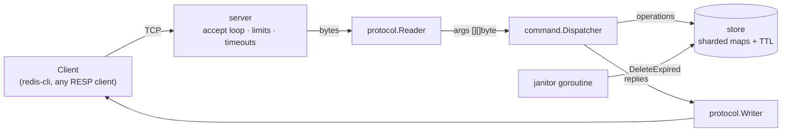

# CacheKV

[](https://github.com/alfonsosantana/cachekv/actions/workflows/ci.yml)
[](LICENSE)

A small, concurrent, in-memory key-value server written in Go that speaks the
Redis protocol (RESP2). It uses **only the standard library** (zero third-party
dependencies) and works with the stock `redis-cli` and Redis client libraries.

CacheKV is a learning and portfolio project, not a Redis replacement. Its goal
is to show how a networked Go service can be built cleanly: small packages with
one job each, explicit concurrency, bounded resources, graceful shutdown, and
a serious test suite. See [Limitations](#limitations-and-roadmap) for what it
deliberately does not do yet.

## Quick start

```sh
make build            # static binary in ./bin/cachekv
./bin/cachekv         # listens on :6379

redis-cli SET city Santiago EX 60
redis-cli GET city
redis-cli TTL city
```

No `redis-cli`? Inline commands work over plain TCP:

```sh
printf 'SET k v\r\nGET k\r\n' | nc localhost 6379
```

Or with Docker:

```sh
make docker
docker run --rm -p 6379:6379 cachekv:dev
```

## Supported commands

| Command | Notes |
| --- | --- |
| `PING [msg]`, `ECHO msg` | Connectivity checks |
| `SET key value [EX seconds \| PX millis]` | Replaces any previous value and TTL |
| `GET key` | Expired keys are never returned |
| `DEL key [key ...]`, `EXISTS key [key ...]` | Return how many keys matched |
| `EXPIRE key seconds` | Negative or zero deletes the key, as in Redis |
| `TTL key`, `PTTL key` | `-2` missing, `-1` no expiry |
| `INCR`, `DECR`, `INCRBY key n` | Atomic, overflow-checked, preserve the TTL |
| `DBSIZE`, `FLUSHALL [SYNC\|ASYNC]` | |
| `COMMAND`, `QUIT` | `COMMAND` returns an empty list so `redis-cli` connects cleanly |

Semantics follow Redis wherever a command overlaps, including error messages.

## Configuration

```
-addr              TCP address to listen on                        (default :6379)
-shards            number of store shards, rounded to power of 2   (default 64)
-janitor-interval  how often expired keys are swept                (default 1s)
-max-conns         maximum simultaneous clients                    (default 10000)
-idle-timeout      close clients idle for this long, 0 = off       (default 5m)
-write-timeout     max time to flush a reply, 0 = off              (default 10s)
-shutdown-timeout  grace period for in-flight connections          (default 10s)
-max-bulk-len      max bytes in one command argument               (default 1 MiB)
-log-level         debug | info | warn | error                     (default info)
-log-json          structured JSON logs
-version           print version and exit
```

`SIGINT` / `SIGTERM` trigger a graceful shutdown (see below). The process exits
`0` after a clean shutdown and `1` on startup or runtime errors.

## Architecture



| Package | Responsibility | Depends on |
| --- | --- | --- |
| `cmd/cachekv` | Flags, logging, signal handling, wiring | everything below |
| `internal/server` | TCP lifecycle, connection limits, timeouts, graceful shutdown | `protocol`, `command` (for the `Replier` type) |
| `internal/command` | Maps parsed commands to store calls, validates arguments, shapes replies | `store` (through a small interface) |
| `internal/protocol` | RESP parsing and encoding, nothing else | standard library only |
| `internal/store` | Sharded key-value storage and expiration | standard library only |

The dependency graph is acyclic and points inwards. `protocol` and `store` know
nothing about each other, which is what makes them easy to test and fuzz in
isolation. `command` depends on interfaces (`Store`, `Replier`) declared where
they are used, so its tests run without sockets.

### Design decisions

**Sharded store.** Keys are spread across a power-of-two number of shards with
FNV-1a (allocation-free, mask instead of modulo). Each shard has its own
`sync.RWMutex`, so unrelated keys do not contend. A single global lock would be
simpler, and is the first thing to measure against.

**Two-layer expiration.** Expired keys are invisible immediately (*lazy*
expiration on read) and reclaimed in the background by a janitor (*active*
expiration). Lazy expiry gives correctness; the janitor bounds memory for keys
that are never read again. The lazy path re-checks under the write lock before
deleting, so a concurrent `SET` can never be lost.

**Injected clock.** The store takes a `func() time.Time`, so every TTL test is
deterministic: no `time.Sleep` in the TTL logic tests.

**Immutable values.** `Set` copies its input and nothing mutates a stored slice
in place, which lets `Get` return it without copying.

**Janitor lifecycle is the caller's job.** `RunJanitor(ctx, interval)` blocks
until the context is cancelled instead of spawning a hidden goroutine inside
`New`. `main` owns the goroutine and waits for it on exit, so there are no
leaks.

**Bounded resources.** A hostile or buggy client cannot exhaust the server:
maximum connections, maximum arguments per command, maximum argument size,
maximum line length, idle and write timeouts. Large bulk payloads are allocated
as the bytes arrive, so announcing a huge length reserves nothing.

**Safe replies.** `\r` and `\n` are stripped from simple strings and errors, so
user-controlled text can never split or forge a reply.

**Fault containment.** A panic inside a command handler becomes an error reply
instead of crashing the process.

**Pipelining.** Replies are buffered and flushed only when the client's already
received input is exhausted, so pipelined commands cost one syscall, not N.

### Graceful shutdown

On `SIGINT`/`SIGTERM`:

1. The listener closes, so no new clients are accepted.
2. Every idle connection is woken immediately (read deadline set to *now*).
3. Commands already executing finish and their replies are flushed.
4. Anything still running after `-shutdown-timeout` is closed forcibly.
5. The janitor is stopped and awaited, then the process exits.

## Testing and quality

```sh
make check   # vet + golangci-lint + tests (what CI runs)
make cover   # coverage summary
make fuzz    # fuzz the protocol parser for 30s
make bench   # store micro-benchmarks
```

- **Unit tests** per package, table-driven, with a fake clock for TTLs.
- **Integration tests** start a real server on a random port and talk to it over
  TCP: pipelining, protocol errors, connection limit, idle timeout, concurrent
  clients, graceful shutdown, and the forced-close path with a hung handler.
- **Race detector** on everything (`go test -race`), including concurrent
  `INCR` tests that would expose lost updates.
- **Fuzzing** (`FuzzReadCommand`) on the only code that parses untrusted bytes.
- **Static analysis**: `go vet`, `golangci-lint` v2 (see [.golangci.yml](.golangci.yml)),
  and `govulncheck` in CI.
- **CI** runs on the oldest supported Go version and on the latest stable.

### Benchmarks

Numbers depend heavily on hardware, so none are quoted here. To measure on
your machine, with `redis-benchmark` installed:

```sh
./bin/cachekv &
redis-benchmark -p 6379 -q -n 200000 -c 50 -t set,get,incr
redis-benchmark -p 6379 -q -n 400000 -c 50 -P 16 -t set,get   # pipelined
```

## Limitations and roadmap

Known limitations, tracked as issues:

- **No persistence.** Data is lost on restart (no RDB/AOF-style snapshot or log).
- **Strings only.** No lists, hashes, sets or sorted sets.
- **No `KEYS`/`SCAN`, no `SET ... NX|XX`, no `MSET`/`MGET`.**
- **No eviction or `maxmemory`.** Memory is bounded only by what clients store.
- **No `AUTH` or TLS.** Do not expose it to untrusted networks.
- **RESP2 only**, and no quoting in inline commands.
- **Janitor sweeps shards in full.** A shard with millions of keys holds its
  lock for the whole sweep. Sampling (as Redis does) would bound the pause.
- **`DBSIZE` may count expired keys** that have not been purged yet.
- **No metrics or `INFO` command.**

## Contributing

Issues and pull requests are welcome, including small ones and including
"I think this is wrong" reports. See [CONTRIBUTING.md](CONTRIBUTING.md).

## License

[MIT](LICENSE)
